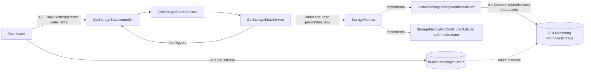

# Plan 009: Estado de Object Storage (métricas del bucket)

Derivado de: `spec.md RF-01..RF-06 + RNF-01..RNF-05` + `constitution.md v1.10-metricas-storage P1-P4,R1-R5,Q1-Q3` + `006 RF-02 + plan 006 §1` (config OCI, Instance Principal).
Alcance: `GET /api/v1/storage/stats → GetStorageStats (controller) → GetStorageStatsUseCase → GetStorageStatsService (caché + periodo del mes + límites) → StorageMetrics (puerto) → OciMonitoringStorageMetricsAdapter → OCI Monitoring SummarizeMetricsData`.

## 1. Arquitectura y componentes



### 1.1 Componentes

* `pom.xml`: `com.oracle.oci.sdk:oci-java-sdk-monitoring` (versión gestionada por el `oci-java-sdk-bom` ya importado; usa el mismo cliente HTTP `jersey3`). Requiere la enmienda v1.10.
* `application/dtos/BucketMetrics`: lo que devuelve OCI, sin cálculos: `record BucketMetrics(long usedBytes, long objectCount, Instant measuredAt, RequestCounts requests)`.
* `application/dtos/RequestCounts`: `record RequestCounts(long total, long get, long put, long list, long head, long delete, long clientErrors)` + `RequestCounts.zero()` (lo que devuelve OCI).
* `application/dtos/StorageStats`: la respuesta: `record StorageStats(Storage storage, Requests requests, Instant generatedAt, boolean stale)` con `record Storage(String tier, long usedBytes, long limitBytes, long objectCount, Instant measuredAt)` y `record Requests(Instant periodStart, long limit, long total, long get, long put, long list, long head, long delete, long clientErrors)`. Sin campos derivados: el frontend calcula y formatea.
* `application/port/out/StorageMetrics`: `BucketMetrics read(Instant periodStart, Instant now)`. Lanza `StorageMetricsUnavailableException` si OCI falla y `StorageNotConfiguredException` sin OCI.
* `application/exception/StorageMetricsUnavailableException` (nueva): Monitoring no respondió y no hay foto previa → `503`.
* `application/port/in/GetStorageStatsUseCase` + `application/services/storage/GetStorageStatsService`: `StorageStats get()`.
  1. Si hay foto y `now − generatedAt < cacheTtl` → la devuelve (RF-04).
  2. Si no, entra en una sección `synchronized` (o `ReentrantLock`) y vuelve a comprobar: solo un hilo consulta OCI aunque lleguen 10 peticiones a la vez con la foto caducada.
  3. `periodStart` = día 1 del mes de `now` a las `00:00Z` (`ZoneOffset.UTC`, RF-03) → `metrics.read(periodStart, now)` → monta `StorageStats` con los límites de configuración (RF-02) → guarda y devuelve con `stale=false`.
  4. `StorageMetricsUnavailableException`: con foto previa → la devuelve con `stale=true` (sin cambiar su `generatedAt`) y `log.warn`; sin foto → relanza (`503`). `StorageNotConfiguredException` siempre se relanza (`503`).
  `Clock` inyectado para controlar el tiempo en los tests. La caché es un campo en memoria: un solo backend, se pierde en un redeploy y se rehace en la primera petición.
* `infrastructure/config/storage/StorageStatsProperties` (`@ConfigurationProperties(prefix = "storage.stats")`): `limitBytes` (`STORAGE_LIMIT_BYTES`, por defecto `10737418240` = 10 GB Standard), `monthlyRequestsLimit` (`STORAGE_REQUESTS_MONTHLY_LIMIT`, por defecto `50000`), `cacheTtl` (`STORAGE_STATS_CACHE_TTL`, por defecto `PT60S`). Un límite `<= 0` → falla al arrancar. Los límites los recibe el servicio desde `infrastructure` (constructor), sin que `application` conozca `@ConfigurationProperties`.
* `infrastructure/config/oci/OciProperties` + `compartmentId` (`OCI_COMPARTMENT_ID`). `OciConfig` + bean `Monitoring` (`MonitoringClient.builder().region(...).build(provider)`, mismo `BasicAuthenticationDetailsProvider`) y `requireConfigured(compartmentId, "OCI_COMPARTMENT_ID", ...)`.
* `infrastructure/adapters/out/metrics/OciMonitoringStorageMetricsAdapter implements StorageMetrics` (`@ConditionalOnExpression` opuesto a `none`, como `OciObjectStorageAdapter`):
  * Una consulta `SummarizeMetricsData` por métrica (MQL no combina métricas), con `compartmentId`, `namespace=oci_objectstorage`, filtro `resourceDisplayName = "<OCI_BUCKET>"` y `.grouping()` para juntar las dimensiones en una sola serie. `StoredBytes`/`ObjectCount` filtran además `tier = "NORMAL"` (así nombra Monitoring al tier Standard, verificado en TASK-009-00). **Toda consulta lleva `startTime` y `endTime` explícitos**: con solo `startTime`, OCI responde vacío (verificado con la CLI).
  * Llamadas: `AllRequests[1h]{…}.grouping().sum()` y las demás `*Requests` + `ClientErrors` con `startTime = periodStart`, `endTime = now`; se suman los `aggregatedDatapoints` (como mucho ~744 por métrica en un mes de 31 días con intervalo `1h`; `periodStart` cae en hora exacta, así que ningún intervalo mezcla dos meses).
  * Espacio: `StoredBytes[1h]{…}.grouping().max()` y `ObjectCount[1h]{…}.grouping().max()` con `startTime = now − 3h` (se publican cada hora); se toma el datapoint más reciente y su `timestamp` es `measuredAt`. Sin datapoints → `0` y `measuredAt = null`.
  * Las 9 consultas en paralelo (`CompletableFuture` sobre un executor acotado) con timeout total de `3 s` (RNF-02). Cualquier `BmcException`, timeout o error de red → `StorageMetricsUnavailableException` (log con `statusCode` y `serviceCode`, nunca OCIDs ni `opc-request-id` completo, RNF-05).
* `infrastructure/adapters/out/metrics/StorageMetricsNotConfiguredAdapter` (`auth-mode=none`): `read` lanza `StorageNotConfiguredException`, igual que `ArtifactStoreAdapter`.
* `infrastructure/adapters/in/web/storage/GetStorageStats`: `@GetMapping("/api/v1/storage/stats", produces = JSON)` → `ResponseEntity.ok().cacheControl(maxAge(cacheTtl restante o 60 s), public)` del `StorageStats`. Sin lógica (R2). Swagger: `@Operation`, `@ApiResponse 200` con ejemplo y `503`.
* `GlobalExceptionHandler` + `StorageMetricsUnavailableException → 503 "storage metrics unavailable"`.
* `SecurityConfig`: `GET /api/v1/storage/stats` `permitAll` (como los streams SSE). CORS: la allowlist existente ya cubre `/api/**`.
* `application.yaml`: bloque `storage.stats.*` con `${VAR:default}`; `oci.compartment-id: ${OCI_COMPARTMENT_ID}`. `docker-compose-prod.yaml`: pasar `OCI_COMPARTMENT_ID` (y `STORAGE_*` si se quieren cambiar) a la lista `environment`.

## 2. Contratos de Datos / Interfaces

* `GET /api/v1/storage/stats` → `200 application/json`, cabecera `Cache-Control: max-age=60, public`:
  ```json
  {
    "storage": {
      "tier": "STANDARD",
      "usedBytes": 2684354560,
      "limitBytes": 10737418240,
      "objectCount": 312,
      "measuredAt": "2026-10-14T15:00:00Z"
    },
    "requests": {
      "periodStart": "2026-10-01T00:00:00Z",
      "limit": 50000,
      "total": 1840, "get": 1710, "put": 96, "list": 0, "head": 4, "delete": 0, "clientErrors": 30
    },
    "generatedAt": "2026-10-14T15:42:07Z",
    "stale": false
  }
  ```
* `503 application/problem+json`: `{"status":503,"detail":"storage metrics unavailable"}` u `"OCI_NOT_CONFIGURED"`.
* Variables nuevas: `OCI_COMPARTMENT_ID` (obligatoria si `OCI_AUTH_MODE != none`), `STORAGE_LIMIT_BYTES`, `STORAGE_REQUESTS_MONTHLY_LIMIT`, `STORAGE_STATS_CACHE_TTL` (opcionales).
* IAM (lo crea el dev en consola, añadido a la política del dynamic group `communitylab-vm`):
  ```text
  Allow dynamic-group communitylab-vm to read metrics in compartment communityLab where target.metrics.namespace = 'oci_objectstorage'
  ```

## 3. Decisiones técnicas y trade-offs

* Decisión: todas las cifras salen de OCI Monitoring.
  Alternativa descartada: `getBucket(approximateSize, approximateCount)` para el espacio + Monitoring para las llamadas; contador propio en Redis.
  Razón: un único permiso nuevo (`read metrics`, limitado a un namespace) en vez de añadir `BUCKET_READ` sobre el bucket; un solo cliente y un solo modo de fallo. Monitoring ve las lecturas por PAR del navegador, que el backend no puede contar.
* Decisión: `GET` REST con caché en el servicio (`PT60S`) + `Cache-Control`.
  Alternativa descartada: evento SSE periódico; stream SSE propio.
  Razón: los datos cambian por minuto (llamadas) u hora (espacio); con caché, el coste en OCI es fijo (≤ 9 consultas/min) y no depende del número de pestañas.
* Decisión: la caché vive en `application` (servicio) y no en el adapter.
  Alternativa descartada: caché en el adapter; `spring-boot-starter-cache` + Caffeine.
  Razón: "servir la foto anterior como `stale` si OCI falla" es una regla del caso de uso y se prueba sin Spring; una dependencia de caché para una sola entrada no se justifica (stack cerrado).
* Decisión: `.grouping()` en MQL para sumar las dimensiones (`tier`) en OCI.
  Alternativa descartada: recibir una serie por `tier` y sumar en Java.
  Razón: menos datos de vuelta y la suma la define la consulta, no el código.
* Decisión: `StoredBytes`/`ObjectCount` con ventana fija de 3 h y el último valor.
  Razón: se emiten cada hora; 3 h tolera un retraso de publicación sin depender del periodo de llamadas.
* Decisión: el backend envía `usado` + `límite` sin campos derivados.
  Alternativa descartada: enviar `availableBytes`/`usedPercent` o textos formateados.
  Razón: el frontend ya decide cómo pintarlo (`x / 10 GB Standard`, `x / 50 000 este mes`); un solo dato de cada cosa evita contradicciones de redondeo entre backend y frontend.
* Decisión: llamadas del mes natural en UTC frente a `50000`.
  Alternativa descartada: ventana móvil configurable (`PT24H`).
  Razón: el margen gratuito de OCI es mensual (50 000 peticiones/mes); solo un periodo igual al suyo permite leer `x / 50 000`.
* Decisión: límite configurable con 10 GB por defecto, medido sobre el tier Standard.
  Alternativa descartada: 20 GB combinados de todos los tiers (margen de una cuenta solo Always Free).
  Razón: OCI no tiene cuota por bucket; el bucket es Standard y la cuenta tiene 10 GB por tier (créditos o pago). Si la cuenta pasa a solo Always Free, se cambia `STORAGE_LIMIT_BYTES` sin tocar código.

## 4. Estrategia de pruebas

Los tests se escriben tras implementar cada tarea.

* Unit `GetStorageStatsServiceTest` (puerto `StorageMetrics` mockeado, `Clock` fijo/mutable): `periodStart` = día 1 del mes a las `00:00Z` (14 oct → 1 oct; 1 nov 00:30Z → 1 nov; 31 dic 23:59Z → 1 dic); límites de configuración en la respuesta; uso por encima del límite enviado sin recortar; foto vigente → no llama al puerto; caducada → llama una vez; 10 hilos concurrentes con foto caducada → una sola llamada; fallo con foto previa → `stale=true` y mismo `generatedAt`; fallo sin foto → `StorageMetricsUnavailableException`; `StorageNotConfiguredException` se propaga; tras un `stale`, la siguiente lectura correcta vuelve a `stale=false`.
* Unit `OciMonitoringStorageMetricsAdapterTest` (cliente `Monitoring` mockeado, solo en el borde del SDK): construye 9 consultas con el namespace, el filtro del bucket, `.grouping()` y el periodo (`startTime = periodStart`) correctos; suma los datapoints de las llamadas; toma el último datapoint de `StoredBytes`/`ObjectCount` y su `timestamp`; sin datapoints → `0`; `BmcException 403/429/500` y timeout → `StorageMetricsUnavailableException`; el log no contiene el OCID del compartment.
* Unit `StorageStatsPropertiesTest` / arranque: un límite `<= 0` → falla al arrancar; `OCI_COMPARTMENT_ID` ausente con `auth-mode != none` → falla al arrancar.
* `webmvc-test` `GetStorageStatsTest`: `200` con el JSON del contrato (`periodStart` ISO-8601, `limit`, `limitBytes`, sin `availableBytes`/`usedPercent`, `Cache-Control`); `StorageMetricsUnavailableException` → `503` ProblemDetail; `StorageNotConfiguredException` → `503`; sin namespace/OCID/bucket en el cuerpo; CORS desde un origen permitido.
* `SwaggerDocsTest` (+): aparece `GET /api/v1/storage/stats` con ejemplo y `503`.

## 5. Verificación

* `./mvnw test -Dtest=GetStorageStatsServiceTest,OciMonitoringStorageMetricsAdapterTest,GetStorageStatsTest,SwaggerDocsTest` + `./mvnw test`.
* Local con `OCI_AUTH_MODE=session-token`: `curl -s localhost:8080/api/v1/storage/stats | jq` → `200`, `usedBytes` coherente con la consola del bucket (pestaña Metrics). Segunda llamada antes de 60 s → mismo `generatedAt`.
* VM: crear la política IAM de §2, desplegar, `curl` al endpoint → `200`. Abrir varias PAR desde el navegador, esperar ~5 min y comprobar que `requests.get` y `requests.total` suben; `requests.periodStart` es el día 1 del mes. Quitar temporalmente la política → `200 stale=true` (con foto previa) o `503` (sin ella).
