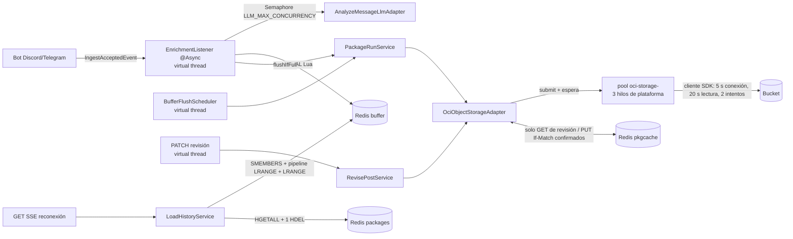

# Plan 010: Optimización de rendimiento (Redis, historial SSE, hilos y caché de paquetes)

Derivado de: `spec.md RF-01..RF-09 + RNF-01..RNF-06` + `constitution.md v1.13-optimizacion P4,R6,Q3` + `plan 006 §3` (buffer, sellado, pendientes) + `plan 007 §1.2` (revisión con `If-Match`) + `plan 008 §1.1, §3` (historial e índice).
Alcance: solo `infrastructure/` y dos cambios mínimos en `application/` (`BufferPort.readSealedAll`, `ArtifactStore.loadFresh`). Sin endpoints, eventos ni dependencias nuevas.

## 1. Arquitectura y componentes



### 1.1 Componentes

| Componente | Capa | Cambio |
|---|---|---|
| `RedisConfig` | infrastructure/config | `LettuceClientConfiguration` con `commandTimeout` y `SocketOptions.connectTimeout`, leídos de `spring.data.redis.timeout` y `connect-timeout` (RF-01). |
| `application.yaml` | config | `spring.data.redis.timeout/connect-timeout` (`${REDIS_TIMEOUT:2000ms}`) se mueven desde `application-dev.yaml`; `spring.threads.virtual.enabled: true`; se elimina `spring.task.scheduling.pool.size` (sin efecto con virtual threads); `storage.package-cache-ttl`, `llm.max-concurrency`. |
| `RedisBufferAdapter` | infrastructure/adapters/out | `appendToBatch` con `DefaultRedisScript<Long>` (RF-02); `discardSealed` en `MULTI/EXEC` (RF-03); `readSealedAll` con `executePipelined` (RF-04); helper `deserialize` común. |
| `BufferPort` | application/port/out | `readSealedAll(Source, Collection<String>)`. |
| `LoadHistoryService` | application/services | Una llamada a `readSealedAll` en lugar del bucle (RF-04). |
| `RedisPackageIndexAdapter` | infrastructure/adapters/out | Junta las vencidas y hace un único `HDEL` varargs, en su propio `try` (RF-05). |
| `OciObjectStorageAdapter` | infrastructure/adapters/out | Pool privado de 3 hilos de plataforma `oci-storage-*` para cada llamada al SDK, cerrado en `DisposableBean` (RF-06); lectura del cuerpo cortada en 1MB; usa `RedisPackageCache` solo en revisión (`putIfAbsent` tras GET, `put` tras `PUT If-Match`) e invalida antes de cada `replace` (RF-08); `loadFresh` (RF-09). |
| `OciConfig` | infrastructure/config | Bean `ClientConfiguration` del cliente Object Storage: `connectionTimeoutMillis`, `readTimeoutMillis`, `RetryConfiguration` (`MaxAttemptsTerminationStrategy`, backoff con jitter ≤ 2 s) desde `oci.connect-timeout/read-timeout/max-attempts` (RF-06). Monitoring (009) no cambia. |
| `SseEventPublisherAdapter` | infrastructure/adapters/out | `heartbeat()` con `tryLock`: si el anterior sigue en curso, se salta (RNF-02). |
| `RedisPackageCache` | infrastructure/adapters/out/cache | `get/put/putIfAbsent/evict` sobre `pkgcache:{SOURCE}:{batchId}` = JSON `{etag, pkg}`, TTL; best effort: cualquier `RuntimeException` (Redis, JSON o `InvalidAssetException` del dominio) = miss (RF-08). |
| `ArtifactStore` | application/port/out | `default loadFresh(...)`, que por defecto llama a `load` (el adapter degradado no cambia). |
| `RevisePostService` | application/services | Si `expectedVersion > versionMessage` leído → una lectura con `loadFresh` antes del `409` (RF-09). |
| `AnalyzeMessageLlmAdapter` | infrastructure/adapters/out | `Semaphore(LLM_MAX_CONCURRENCY)`, antes fijo en `3`; falla al arrancar si es `< 1` (RF-07). |
| `docker-compose-prod.yaml` | despliegue | Variables opcionales `REDIS_TIMEOUT`, `LLM_MAX_CONCURRENCY`, `PACKAGE_CACHE_TTL`, `OCI_CONNECT_TIMEOUT`, `OCI_READ_TIMEOUT`, `OCI_MAX_ATTEMPTS`. |

## 2. Contratos de Datos / Interfaces

* Script de append (`KEYS = ids, list, bytes`; `ARGV = messageId, json, tamañoBytes`):
  ```lua
  if redis.call('SADD', KEYS[1], ARGV[1]) == 1 then
    redis.call('RPUSH', KEYS[2], ARGV[2])
    return redis.call('INCRBY', KEYS[3], ARGV[3])
  end
  return 0
  ```
  Las tres keys son de la misma fuente (`buffer:{SOURCE}:current:*`): un script nunca mezcla fuentes.
* Copia del paquete: `pkgcache:{DISCORD|TELEGRAM}:{batchId}` → `{"etag":"…","pkg":{…AssetPackage…}}`, `EX = PACKAGE_CACHE_TTL`.
* Variables nuevas, todas opcionales: `LLM_MAX_CONCURRENCY` (default `3`), `PACKAGE_CACHE_TTL` (default `24h`), `OCI_CONNECT_TIMEOUT` (`5s`), `OCI_READ_TIMEOUT` (`20s`), `OCI_MAX_ATTEMPTS` (`2`). `REDIS_TIMEOUT` ya existía, pero solo en dev.
* Cuándo se escribe o borra la copia:

  | Operación | Resultado OCI | Caché |
  |---|---|---|
  | `save` (flush) | cualquiera | nada (la copia nace en la primera revisión) |
  | `load` | hit | se devuelve, sin GET |
  | `load` | miss → GET `200` (< 1MB) | `putIfAbsent(pkg, etag del GET)` (`SET NX`) |
  | `load` | `404` / `>= 1MB` / error | nada |
  | `loadFresh` | — | `evict` → GET → `putIfAbsent` |
  | `replace` | antes del PUT | `evict` |
  | `replace` | `REPLACED` | `put(pkg revisado, etag nuevo)` |
  | `replace` | `412` / fallo / timeout | queda vacío |

## 3. Decisiones técnicas y trade-offs

* Decisión: script Lua para el append.
  Alternativa descartada: `MULTI/EXEC` (no permite decidir el `RPUSH` según el resultado del `SADD` dentro de la transacción); pipeline (un solo viaje, pero no atómico).
  Razón: es el único mecanismo que hace atómico el "si es nuevo, entonces guárdalo y cuéntalo" en un solo viaje. Corrige la pérdida de mensajes y ahorra 2 viajes por mensaje. Requiere la enmienda v1.13 (v1.2 decía "sin Lua").
* Decisión: `MULTI/EXEC` para `discardSealed` y pipeline para `readSealedAll`.
  Alternativa descartada: Lua en ambos.
  Razón: no hay decisión condicional; basta con `MULTI` (atómico) y con un pipeline (lectura, no necesita atomicidad). Es el mismo patrón que el sellado de 006.
* Decisión: un único `HDEL` varargs al final de `active`.
  Alternativa descartada: migrar el índice a `ZSET` por `expiresAt`.
  Razón: con `HDEL` varargs el número de viajes ya es fijo, sin migrar datos de un índice que está en uso.
* Decisión: `spring.threads.virtual.enabled=true`.
  Alternativa descartada: `ThreadPoolTaskExecutor` dimensionado para 2 núcleos.
  Razón: el trabajo es I/O (LLM hasta 15 s, Redis, SSE). Con 2 núcleos un pool de plataforma o se queda ocioso o encola. Un virtual thread esperando no ocupa núcleo.
* Decisión: las llamadas al SDK de OCI van a un pool **privado** de 3 hilos de plataforma dentro del adapter, y el límite de tiempo lo pone el **cliente del SDK** (`ClientConfiguration`: 5 s de conexión, 20 s de lectura, 2 intentos).
  Alternativa descartada: un bean `Executor` inyectado en `PackageRunService`; todo en virtual threads; esperar el `Future` con un tope de tiempo (`future.get(timeout)`).
  Razón: en JDK 21 el cliente HTTP bloqueante del SDK fija el virtual thread (pinning), y con 2 portadores dos subidas lentas congelarían todo. Un bean `Executor` haría que Spring Boot desactivara su `applicationTaskExecutor` (`OnExecutorCondition`) y `@Async` acabaría en ese pool. Dentro del adapter protege también el `PATCH`, igual que hace `OciMonitoringStorageMetricsAdapter`. 3 hilos = 2 flushes de fuente (los locks por fuente no permiten más) + 1 libre para el `PATCH`; son hilos que esperan red, no compiten por los 2 núcleos. El tope en el `Future` (primera versión) era incorrecto: `cancel(true)` no detiene una llamada HTTP bloqueante, así que el hilo seguía ocupado (60 s × hasta 8 intentos por defecto del SDK) y un PUT que OCI aplicaba tarde se informaba como fallo. Solo el cliente puede cortar su propia llamada. Verificado con una petición HTTP real contra un servidor que no responde (SDK 3.97.0, JDK 21).
* Decisión: el límite del LLM es el `Semaphore` del adapter, ahora configurable.
  Alternativa descartada: `spring.task.execution.simple.concurrency-limit`.
  Razón: el límite del executor bloquea a quien envía la tarea (el hilo del bot) cuando se llena. El semáforo bloquea al virtual thread de la tarea, cosa que no cuesta nada.
* Decisión: confiar en la copia de Redis y validar al escribir con `If-Match`.
  Alternativa descartada: validar cada hit con `GET If-None-Match` (`304`).
  Razón: el `304` sigue contando como petición en la cuota de OCI. El único escritor del bucket es este adapter, y `replace` ya envía `If-Match`, así que una copia desactualizada termina en `412 → evict → relectura`.
* Decisión: el caché solo se escribe tras una confirmación de OCI en una revisión (GET o `PUT If-Match`), y se invalida antes de cada `replace`.
  Alternativa descartada: escribir antes del PUT (write-behind); cachear también en el flush; invalidar solo cuando OCI falla.
  Razón: requisito del dev, porque el bucket es el único almacenamiento persistente (constitución §2) y Redis nunca debe tener un paquete que no esté en él. Cachear en el flush llenaba la Redis del buffer con paquetes que casi nunca se revisan. Invalidar antes del PUT garantiza que un fallo posterior (interrupción, timeout, `put` fallido) nunca deja la versión anterior: el camino "sin cambios" del `PATCH` no llega al `If-Match` y respondería con datos viejos.
* Decisión: `SET NX` para la copia que deja un GET, `SET` para la de un `PUT If-Match` aceptado.
  Alternativa descartada: `SET` siempre; comparar etags en Redis (Lua).
  Razón: un GET lento puede terminar después de que una reescritura concurrente guardara la versión nueva. Con `NX` la lectura solo llena un hueco vacío, y como `replace` invalida antes del PUT y escribe después, el orden siempre deja la versión más nueva.
* Decisión: el heartbeat SSE salta si el anterior sigue en curso (`tryLock`).
  Alternativa descartada: un `ThreadPoolTaskScheduler` de plataforma; esperar el lock.
  Razón: con virtual threads `SimpleAsyncTaskScheduler` lanza cada `fixedRate` en un hilo nuevo sin esperar al anterior; un cliente que dejó de leer bloquea la escritura (hasta el timeout del socket) y los heartbeats se apilaban. Un bean `TaskScheduler` de plataforma también es un `Executor` y desactivaría el `applicationTaskExecutor` (ver arriba). Saltar un latido es inocuo: el siguiente llega a los 30 s, bajo el corte de 100 s de Cloudflare.
* Decisión: TTL `24h`.
  Alternativa descartada: el TTL de la PAR (7 días).
  Razón: las revisiones se concentran en las horas siguientes al paquete; 24 h acota la memoria de Redis (~900 KB por paquete revisado).

## 4. Riesgos

* Un cambio del bucket hecho fuera del backend (consola) deja la copia desactualizada hasta el siguiente `PATCH`. Eso lo cubren RF-09 (`expectedVersion` mayor) y el `412` del `If-Match`. Un `expectedVersion` menor se responde con `409`, lo cual es correcto.
* Con virtual threads, `spring.task.scheduling.pool.size` deja de aplicar. `@Scheduled` corre en virtual threads, y el heartbeat SSE y el flush siguen cubiertos por sus propios locks.
* El lock por fuente de `PackageRunService` (`ReentrantLock`) y el `Semaphore` del LLM no fijan virtual threads (usan `j.u.c`, no `synchronized`).
