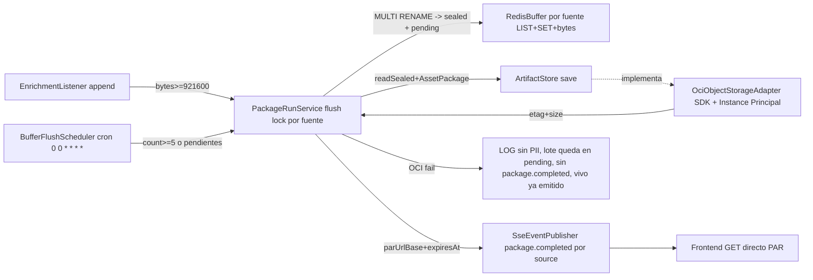

# Plan 006: Almacenamiento OCI opción A + lectura directa PAR

Derivado de: `spec.md RF-01..RF-07 + RNF-01..RNF-06` + `constitution.md v1.9-revision-versionada R1,R4-R6,Q3-Q4,Fase 1` (escrito sobre v1.8-buffer-por-fuente) + `004-paquete-oci-health RF-01/RF-02/RNF-01/RNF-02`.
Alcance: `Bot → LLM por mensaje (002) → etiquetas (003) → fork SSE vivo + RPUSH Redis **al lote de su fuente** → cierre por bytes o por hora (>=5) → sellado atómico → 1 PUT → 1 CreatePAR read → SSE package.completed con URL → frontend GET directo a OCI`. Solo `DISCORD #Listen` para demo, `TELEGRAM` mismo patrón. Redis: keys por fuente `buffer:{SOURCE}:*` + sellado y pendientes; el umbral de bytes vive en `PackageRunService` (no en el adapter). Opción A fijada: `1 lote = 1 objeto = 1 PAR read por objeto`.

> Nota TTL: el TTL es solo de la URL PAR, no del objeto. El objeto persiste hasta borrado/lifecycle; la PAR vence; en re-flush (`412`) se crea una PAR nueva (enmienda 2026-10-10: OCI no devuelve la URL de una PAR existente, ver §3).

## 1. Arquitectura y componentes

* `domain` (puro, sin `org.springframework`/`jakarta.persistence`, R1-R3): `AssetPackage{batchId lote, generatedAt, source: DISCORD|TELEGRAM, enriched: EnrichedComment[] (cada registro con su post LINKEDIN/X/FAQ, 1 duda = 1 post, + authorId/authorName/channelId/messageId para trazabilidad), stats:{received, analyzed, fallbackCount, assetsCount}, promptVersion: "v1"}` + `PackageStats` + validación `enriched[]` no vacío. Sin `assets[]` (enmienda spec §4 2026-10-08: duplicaría el post que ya lleva cada `EnrichedComment`). La guarda `<1048576 bytes` vive en el adapter OCI (bytes reales tras serializar; el dominio no tiene serializador). Anonimato solo ante el LLM; OCI conserva usuario; logs prod solo `messageId/batchId/source`.
* `application` (sin `@Controller`, sin SDKs) — *diseño original; el flujo `synchronized` + `LRANGE → DEL` queda reemplazado por §1.1 (lock por fuente + sellado `MULTI/RENAME` + pendientes)*: `ports/in PackageRunUseCase.flush(batchId)` + `ports/out ArtifactStorePort{put, exists, createReadPar, listPars}` + `ports/out BufferPort{getCurrentBatchId, append, flushIfNeeded, readBatch, rotate}` (extiende `BufferPort` actual de 2 métodos) + `services BufferService + PackageRunService` (solo Java sin Lua: `SADD ids messageId` dedup → `RPUSH list json` → `INCRBY bytes len` → si `>=900KB` flush `synchronized`: `LRANGE` → envuelve en `assets[]` → `put paquete-{batchId}.json` → `exists? deduped:true` → `listPars? reuse deduped:true : create` → `SSE package.completed` → `DEL + nuevo uuid lote`; `LLM_FALLBACK` entra como traza auditable, vacío/post-inválido aborta sin OCI).
* `infrastructure` (adapters implementan ports, P2): `OciObjectStorageAdapter` (único que toca SDK: ~~`PutObject + GetNamespace auto + CreatePreauthenticatedRequest ObjectRead + ListPreauthenticatedRequests` solo en re-flush~~ *implementado:* `PutObject` create-only (`If-None-Match: *`) + `CreatePreauthenticatedRequest ObjectRead` en cada guardado y re-flush; namespace por `OCI_NAMESPACE` sin `GetNamespace` en runtime; sin `ListPreauthenticatedRequests` (enmienda 2026-10-10, §3); `GetObject` + `PutObject If-Match` solo para la revisión de spec 007) + `OciConfig` (`InstancePrincipalsAuthenticationDetailsProvider` en prod, bean desactivado en local/test → `OCI_NOT_CONFIGURED` con SSE vivo intacto, mismo patrón que `REDIS_NOT_CONFIGURED`) + `RedisBufferAdapter` completado (`LRANGE/DEL/nuevo uuid`; hoy sin flush) + `SseEventPublisherAdapter` extendido a `package.completed {type, batchId, payload:{assetsCount, parUrlBase, expiresAt}}` por `source` (dual-get, `Last-Event-ID` replay intacto).
* `infrastructure/adapters/in/web`: `GetMessagesProcessedDiscord + GetMessageProcessedTelegram` existentes emiten `asset.created` + `package.completed` por su stream; `GET /actuator/health -> UP`; Swagger solo `GET SSE + health`, sin `GET /packages*` (004 RF-08 sigue: lectura histórica es frontend→OCI, no frontend→backend).
* `config / despliegue`: base `application.yaml` solo no-secretos `${OCI_BUCKET/OCI_REGION/OCI_NAMESPACE/OCI_PREFIX/PAR_TTL_DAYS:3/REDIS_BUFFER_MAX_BYTES:921600}` (`OCI_PREFIX` sin default, obligatoria con modo OCI activo, §3); ~~`application-prod.yaml` mismos keys con valores OCI reales~~ *estado 2026-10-13 (`sdd-audit`):* `application-prod.yaml` **no existe**; la base fuerza `spring.profiles.active: dev` y Redis, CORS (`cors.allowed.origins`), actuator y logging viven solo en `application-dev.yaml`. Antes de TASK-006-05 hace falta `application-prod.yaml` (activado por `SPRING_PROFILES_ACTIVE=prod`) con Redis, `cors.allowed.origins` por env, exposición `health,info` y logging sin `DEBUG` en adapters (RNF-06); sin él la VM corre con `dev` o no arranca (`CorsConfig` exige `cors.allowed.origins`); nunca `.env/*-local.yaml/*.pem/*.key/token*.json/.oci/` (R4). Docker en VM permite egress a `169.254.169.254` + `objectstorage.{region}.oraclecloud.com`.
* `IAM (propuesta + TBD cuenta §6 spec)`: `dynamic-group communitylab-vm` + `Allow dynamic-group to manage objects in compartment where target.bucket.name='MessagesUsers'` (compartment `communityLab`) recortado a `OBJECT_CREATE + OBJECT_OVERWRITE + PAR_MANAGE (+ OBJECT_READ solo para otorgar PAR read, sin Get/List en negocio)`; región propuesta `sa-saopaulo-1`. *Enmienda 2026-10-09 (spec 007):* `GetObject` permitido solo en la revisión de posts y `OBJECT_OVERWRITE` obligatorio; bucket con Object Versioning. El flush de 006 sigue create-only.

### 1.1 Componentes implementados (fase buffer, 2026-10-06)

* `domain`: `AssetPackage{batchId, source, generatedAt, enriched[], stats, promptVersion}` + `PackageStats{received, analyzed, fallbackCount, assetsCount}` + `objectName() -> "{source}/paquete-{batchId}.json"` (validación: `batchId`, `source` y `enriched` no vacíos). El campo `assets[]` (Asset de 003) aún no existe: el paquete lleva `enriched[]` (1 duda = 1 post).
* `application/port/out/BufferPort`: `getCurrentBatchId(Source)`, `long appendToBatch(EnrichedComment)` (devuelve bytes del lote; `0` si dedup/error), `countMessages(Source)`, `Optional<String> sealCurrentBatch(Source)`, `pendingBatches(Source)`, `readSealed(Source, batchId)`, `discardSealed(Source, batchId)`.
* `application/port/out/ArtifactStore`: `StoreResult save(AssetPackage)` (`StoreResult{ok, deduped}`).
* `application/port/in/PackageRunUseCase` + `services/storage/PackageRunService`: `flushIfFull(Source, bytes)` (`>= maxBytes`) y `flushScheduled()` (por cada `Source`, `count >= minMessages`; un fallo de una fuente no corta a la otra). Flujo: `tryLock(source)` → reintenta `pending` → `sealCurrentBatch` → `readSealed` → `save` → `discardSealed` solo si `ok`.
* `infrastructure/adapters/out/buffer/RedisBufferAdapter`: keys `buffer:{SOURCE}:current:{id|ids|list|bytes}`, `buffer:{SOURCE}:sealed:{batchId}`, `buffer:{SOURCE}:pending`; sellado con `SessionCallback` + `MULTI/EXEC`.
* `infrastructure/adapters/out/storage/ArtifactStoreAdapter`: modo degradado `OCI_NOT_CONFIGURED` (devuelve `StoreResult.failed()` → el lote queda pendiente). ~~Lo reemplaza el adapter OCI real (TASK-006-03).~~ Se conserva solo con `oci.auth-mode=none`; con modo OCI activo se carga `OciObjectStorageAdapter` (exactamente 1 `ArtifactStore` por modo, TASK-006-03).
* `infrastructure/adapters/in/scheduler/BufferFlushScheduler` (`@Scheduled(cron)`, solo delega) + `infrastructure/config/scheduling/SchedulingConfig` (`@EnableScheduling`), ambos `@ConditionalOnProperty(buffer.flush.scheduler.enabled, matchIfMissing=true)`; `false` en tests.
* `EnrichmentListener`: tras SSE `asset.created` → `appendToBatch` → `flushIfFull(source, bytes)`.

## 2. Contratos de Datos / Interfaces

* Key: `paquetes/{source}/paquete-{batchId lote}.json` (`{source}` en minúsculas, lo da `AssetPackage.objectName()`; el prefijo `paquetes/` lo añade infraestructura), `Content-Type: application/json`, `<1MB`, cifrado OCI default Always Free.
* ~~`ArtifactStorePort`: `put(key,bytes)->{etag,sizeBytes}`, `exists(key)->bool`, `createReadPar(object,ttlDays)->{parUrl,expiresAt}`, `listPars(bucket)->[{parId,object,expiresAt}]` (solo re-flush para `deduped:true`, no en path caliente).~~ *Implementado:* `ArtifactStore.save(AssetPackage) -> StoreResult{status: STORED|ALREADY_STORED|FAILED, parUrl, expiresAt}` (+ `load/replace` de spec 007).
* SSE: `{type:"package.completed", batchId, payload:{assetsCount:N, parUrlBase:"https://...", expiresAt:"ISO-8601"}}`, `id=batchId`, sin contenido ni PII ni PAR en logs. Fallo OCI → sin evento.
* Re-flush mismo `batchId`: objeto existe → `deduped:true` sin re-PUT; ~~PAR vigente existe → `deduped:true` sin `CreatePAR`~~ → **siempre `CreatePAR` nueva** (enmienda 2026-10-10, §3).
  - *Implementado 2026-10-08:* `exists(key)` + `put` se sustituye por **un** `PutObject` con `If-None-Match: *` (create-only atómico en OCI): `412` = ya guardado → `StoreResult.alreadyStored()` (`ok:true, deduped:true`, el lote se descarta). Razón: `exists → put` deja un hueco TOCTOU (dos intentos ven "no existe" y ambos escriben) y cuesta 2 llamadas; el caso real es el reintento tras `PUT` ok + `discardSealed` fallido. Puerto actual `ArtifactStore.save(AssetPackage) -> StoreResult{ok, deduped}`; crece con `parUrl/expiresAt` al implementar la PAR.
* Env: `OCI_AUTH_MODE=none|session-token|instance-principal` (default `none`), `OCI_CONFIG_PROFILE` (solo `session-token`), `OCI_BUCKET`, `OCI_REGION`, `OCI_NAMESPACE`, `OCI_PREFIX` (valor `paquetes/`, obligatoria sin default), `PAR_TTL_DAYS=3`, `SPRING_PROFILES_ACTIVE=prod` (VM), `REDIS_BUFFER_MAX_BYTES=921600`, `BUFFER_FLUSH_CRON=0 0 * * * *`, `BUFFER_FLUSH_MIN_MESSAGES=5`, `BUFFER_FLUSH_SCHEDULER_ENABLED=true`, `REDIS_HOST/PORT`.
* Keys Redis por fuente: `buffer:{SOURCE}:current:id|ids|list|bytes`, `buffer:{SOURCE}:sealed:{batchId}`, `buffer:{SOURCE}:pending`.

## 3. Decisiones técnicas y trade-offs

* Decisión: añadir `com.oracle.oci.sdk:oci-java-sdk-objectstorage` tras `ArtifactStorePort`.
  Alternativa descartada: REST manual / CLI / placeholder `InMemory/FileSystem`.
  Razón: en tabla constitucional Storage; `Put + CreatePAR + ListPARs` sin deuda; tests mockean cliente. Requiere verificar compatibilidad `Boot 4.1.1 + Java 21` en `TASK-006-00`.
* Decisión (TASK-006-00): SDK modular `oci-java-sdk-bom 3.97.0` + `oci-java-sdk-objectstorage` + cliente HTTP `oci-java-sdk-common-httpclient-jersey3` (Jakarta, no `javax`), con override en `pom.xml` de `jersey.version=3.0.8` y `jakarta-ws-rs.version=3.0.0` (valores que pide `oci-java-sdk-common-httpclient-jersey3:3.97.0`).
  Alternativa descartada: (B) `oci-java-sdk-shaded-full` (~186MB, trae todos los servicios OCI: imagen Docker, arranque `<15s` y superficie de CVEs); (C) `<exclusions>` + versiones fijadas a mano por artefacto Jersey (N líneas a mantener en cada subida del SDK); dejar las versiones de Boot (Jersey `4.0.2` + `hk2 4.0.0-M3` milestone mezclado con `jersey-apache-connector 3.0.8`: combinación que OCI no declara ni prueba; un `GetNamespace` firmado contra stub local funciona también con ella (`OciConfigTest`, 2026-10-08), así que es riesgo no soportado, no fallo demostrado).
  Razón: el BOM de Boot hereda prioridad sobre el BOM importado de OCI y sobreescribe transitivas; el override por propiedad es el mecanismo idiomático de Boot. Seguro porque Jersey y `jakarta.ws.rs` solo los trae OCI (verificado con `dependency:tree`; Spring MVC usa Servlet, no JAX-RS). `jakarta-annotation.version` **no** se sobreescribe (OCI pide `2.1.1`, Boot `3.0.0`): la usa Spring Framework y la 3.0 es compatible hacia atrás. Mantenimiento: al subir `oci-sdk.version`, realinear ambas propiedades con las del pom `jersey3` del SDK.
* Decisión: `InstancePrincipalsAuthenticationDetailsProvider` transparente en prod, degradado `OCI_NOT_CONFIGURED` en local/test.
  Alternativa descartada: API Key con `OCI_*_KEY` en env.
  Razón: mismo ecosistema VM + bucket, cero secretos/rotación/brechas de config; no tumba SSE vivo en local.
* Decisión (enmienda 2026-10-08): selector `oci.auth-mode` (`OciProperties.authMode: OciAuthMode`, env `OCI_AUTH_MODE`; enum para fail-fast ante valor inválido) = `none` (default) | `session-token` (dev) | `instance-principal` (prod). `none` → sin cliente OCI, `ArtifactStoreAdapter` degradado `OCI_NOT_CONFIGURED`; `session-token` → `SessionTokenAuthenticationDetailsProvider` con perfil `oci.config-profile` (`OCI_CONFIG_PROFILE`) de `~/.oci/config`.
  Alternativa descartada: activar OCI por presencia de `OCI_BUCKET` (no distingue portátil probando de VM; Instance Principal fuera de OCI reintenta contra `169.254.169.254` y falla tarde); API Key `~/.oci/config + .pem` en local (secreto permanente, fuera de alcance spec §5); probar solo en la VM (un fallo mezcla código, Jersey, Docker, auth e IAM; cada intento = build + push + deploy).
  Razón: escalera de depuración por capas — (1) CLI local `oci os object put` con sesión → bucket/namespace/región/permisos; (2) app local `session-token` → código del adapter, Jersey, JSON, Content-Type; (3) CLI en VM `--auth instance_principal` → dynamic-group + políticas; (4) contenedor en VM → red Docker/egress. Token de sesión caduca (~1h), fuera de repo/env/imagen (R4). Límite: (2) usa permisos del usuario, no los de la VM; (3) cubre IAM real.
* Decisión: 1 PAR read por objeto/lote, sin `listing enabled`.
  Alternativa descartada: PAR por asset interno, PAR global `paquetes/`, PAR por prefijo con list (opción B).
  Razón: `N lotes = N PUTs + N PARs` (mínimo en opción A); blast-radius por lote revocable; sin `ListObjects` para leer.
* ~~Decisión: `List + reuse` solo en re-flush para `deduped:true`.~~ **Sustituida 2026-10-10.**
* Decisión (2026-10-10): en re-flush (`PutObject` → `412`) crear siempre una PAR nueva sobre el objeto, sin listar ni revocar las anteriores. `StoreResult{status: STORED|ALREADY_STORED|FAILED, parUrl, expiresAt}`. Si `PUT` ok y `CreatePAR` falla → `failed()`: el lote queda en `pending` y el siguiente tick (`412` → `CreatePAR`) lo completa sin código extra.
  Alternativa descartada: `List + reuse` (imposible: `PreauthenticatedRequestSummary` no trae URL; OCI solo la entrega al crear); crear nueva + revocar las anteriores (`List` + `DeletePreauthenticatedRequest`: más llamadas y código para PARs que caducan solas en 1 día); guardar la URL en Redis (secreto fuera de OCI y se pierde al descartar el lote).
  Razón: mínimo código; el reintento se cura solo. Límite: un lote reintentado puede tener >1 PAR vigente hasta `PAR_TTL_DAYS`.
* Decisión: un lote por fuente (`buffer:{SOURCE}:*`).
  Alternativa descartada: lote único mixto Discord+Telegram.
  Razón: `AssetPackage.source` y `package.completed` son por fuente (dual-get); cada fuente con su ritmo y límites; un fallo no arrastra a la otra.
* Decisión: sellar con `MULTI/EXEC` + `RENAME current:list → sealed:{batchId}` + `SADD pending`, sin Lua.
  Alternativa descartada: `LRANGE → PUT → DEL` (plan original), scripts Lua, `STREAM`/consumer groups.
  Razón: `LRANGE + DEL` borra mensajes llegados entre ambas órdenes; `RENAME` aparta el lote de un golpe y los nuevos caen en el lote nuevo; `pending` permite reintentar sin perder datos.
* Decisión: lock por fuente (`EnumMap<Source, ReentrantLock>` + `tryLock`), no `synchronized` global.
  Alternativa descartada: `synchronized` en el método, lock distribuido.
  Razón: evita doble flush tamaño/hora sobre el mismo lote sin que Discord bloquee a Telegram. Límite: válido con una sola instancia del backend.
* Decisión: cierre horario por reloj fijo (`0 0 * * * *`) si `count >= 5` (configurable), además del cierre por `900KB`.
  Alternativa descartada: solo tamaño; antigüedad del lote (timestamp de apertura).
  Razón: con poco tráfico un lote no llegaría nunca a 900KB; el reloj fijo es más simple que guardar timestamp por lote. Cada tick reintenta pendientes aunque haya `<5` mensajes.
* ~~Decisión (2026-10-08): PAR TTL explícito `1d` (`PAR_TTL_DAYS=1`)~~ **TTL sustituido 2026-10-13 por `3d` (decisión siguiente)**; se mantiene: TTL explícito, PAR no editable (crear nueva + revocar anterior).
  Alternativa descartada: `7d` (propuesta inicial); TTL largo implícito o sin expiración.
  Razón: Q3 + rotación por lote; el paquete lleva `authorName/authorId`, menor ventana si la URL se filtra; el objeto persiste aunque la PAR expire; prohibido borrar bucket con PARs asociadas. Límite: sin renovación bajo demanda (no hay `GET /packages*`), un paquete de más de 1 día no es legible por el frontend hasta definir cómo renovar.
* Decisión (2026-10-13, `sdd-audit`): subir `PAR_TTL_DAYS` de `1` a `3` (sustituye la anterior).
  Alternativa descartada: mantener `1` día; `7` días (propuesta inicial); `10` días (alineado con el lifecycle de 007); diseñar ya la renovación bajo demanda (endpoint que choca con 004 RF-08, enmienda constitucional, bloquea el cierre de 006).
  Razón: la revisión de posts (007) dura varios días y la demo/evaluación puede ser días después del flush; con `1` día el dashboard pierde el paquete antes. `3` días cubre ambos casos con la menor ventana de exposición razonable. Límite: no renueva; un paquete de más de 3 días no es legible por el frontend (renovación → Fase 2, spec §5). La revisión de 007 no crea PAR: la existente sirve la versión vigente.
* Decisión (2026-10-13, `sdd-audit`): `OCI_PREFIX` obligatoria sin default con modo OCI activo (`requireConfigured` en `OciConfig`), en vez del default `paquetes/` que decía este plan.
  Alternativa descartada: `${OCI_PREFIX:paquetes/}` en `application.yaml`.
  Razón: con un default la validación fail-fast nunca dispararía para el prefijo; en prod es mejor no arrancar que escribir en un prefijo que nadie eligió. El código ya lo hacía: se corrigen spec y plan, sin cambios de código.
* Decisión (2026-10-12): el umbral de cierre es la garantía del `<1MB`: `PackageRunService` falla al arrancar si `REDIS_BUFFER_MAX_BYTES` sale de `1..921600`; en `OciObjectStorageAdapter`, un paquete `>=1048576` bytes se sube igual con `log.error` (sin `return failed()`).
  Alternativa descartada: rechazar el paquete (`failed()` → reintento infinito: el lote sellado nunca adelgaza y queda retenido en Redis); estado `TOO_LARGE` que lo aparta (más código para un caso inalcanzable y el lote sigue ocupando Redis); dividir en dos objetos (rompe `1 lote = 1 objeto = 1 PAR`).
  Razón: cada registro está acotado por `maxTokens(4000)` del LLM (~16KB) frente a ~124KB de margen; los únicos caminos al exceso son un umbral mal configurado (cerrado al arrancar) o un `tryLock` ocupado varios minutos con mensajes de tamaño máximo (alarma visible). Prioridad: no retener datos en Redis. Límite: en esa anomalía el objeto puede superar el `1MB` por pocos KB.

## 4. Estrategia de pruebas y despliegue

* Unit `AssetPackageTest` (`enriched[]` vacío aborta, stats separan `LLM_FALLBACK`, `objectName` por fuente); `relevance clamp 0..100` y `topics/hashtags null→[]` en `EnrichedCommentTest`; `>=1MB` se sube con alarma `ERROR` en `OciObjectStorageAdapterTest`; umbral fuera de `1..921600` no arranca en `PackageRunServiceTest` + `PackageRunServiceStartupTest`.
* Unit `PackageRunServiceTest` (16), `RedisBufferAdapterTest` (18), `AssetPackageTest` (9), `BufferFlushSchedulerTest` (2) + `EnrichmentListenerTest` / `Ingest*ServiceTest` ajustados al lote por fuente — ver §1.1. Previsto original: `BufferServiceTest, PackageRunServiceTest` con puertos mockeados (Mockito solo en boundaries): dedup `messageId` sin `RPUSH/INCRBY`; `bytes<900KB` sin flush; `>=900KB` → `1 PUT + 1 PAR + SSE + DEL + nuevo uuid`; `OCI-fail` → `LOG` sin `package.completed` con vivo ya emitido; re-`batchId` → `deduped:true` sin re-PUT ni `CreatePAR`.
* Adapter `OciObjectStorageAdapterTest` mockeado (cliente SDK): `put/create/list`, `Content-Type`, keys `paquete-{batchId}`, re-put → `deduped:true`, sin creds → `OCI_NOT_CONFIGURED`.
* Adapter `RedisBufferAdapterTest` mockeado (`RedisTemplate`): `SADD/RPUSH/INCRBY/LRANGE`, `DEL + nuevo uuid`, sin Redis → degradado con SSE intacto.
* `webmvc-test`: `package.completed` por `source` con `Last-Event-ID` replay (`GetMessagesProcessedDiscordTest`, `GetMessageProcessedTelegramTest`), `HealthTest UP`, `SwaggerDocsTest` (solo `GET SSE + health`). Scheduler `enabled=false` en test. Sin PII/PAR en logs.
* Despliegue: Redis local vía `docker-compose-dev.yaml`; prod VM OCI misma región/compartment que bucket; IAM dynamic-group + políticas antes del primer flush; `sdd-audit` obligatorio antes de codificar (*ejecutado a posteriori el 2026-10-13*, ver TASK-006-06); `application-prod.yaml` antes de desplegar (§1 config).

## 5. Verificación

* `./mvnw test -Dtest=*Package*,*Buffer*,*Oci*,*Par*,*Events*,*Health*`
* `./mvnw spring-boot:run` → por mensaje `asset.created + RPUSH`; a `900KB` → flush + `package.completed {batchId, parUrlBase, expiresAt} + ✅` por SSE de su `source`; `GET parUrlBase → 200 application/json`; re-flush mismo `batchId` → `deduped:true`; OCI-caído → `LOG + ⚠️` sin `package.completed`; sin `GET /packages*`; Redis local vía Docker.
